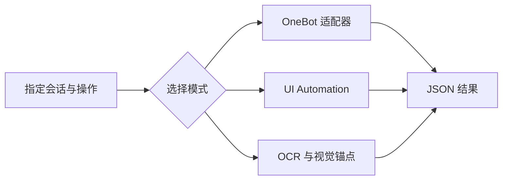

# QQ Desktop Messaging

**Windows QQ 的本地自动化脚本与 Agent 技能，支持适配器、UI Automation 和 OCR 三条路径。**

[技能说明](SKILL.md) · [脚本](scripts/) · [UIA 校准](references/selector-calibration.md) · [视觉校准](references/vision-calibration.md)

通过已登录的 Windows QQ 会话读取近期消息，或在明确指定的会话中发送文本与图片。优先使用 NapCat / OneBot；适配器不可用时，尝试桌面控件和视觉路径。项目面向本地交互式桌面，不支持 macOS QQ，也不是无头聊天服务。

## 模式选择

| 模式 | 路径 | 使用场景 |
| --- | --- | --- |
| `auto` | OneBot → UIA → OCR | 按顺序尝试可用路径 |
| `adapter` | 仅 NapCat / OneBot | 已配置本地适配器 |
| `uia` | 仅 Windows UI Automation | 控件树仍可用 |
| `vision` | 截图、OCR 与模拟输入 | 控件树不可用，需要校准视觉锚点 |



## 运行条件

- Windows 上已登录的 QQ 桌面客户端与 PowerShell。
- 使用桌面回退时，需要未锁定的交互式会话，QQ 窗口不被模态弹窗遮挡。
- 使用适配器时，需要可访问的 NapCat / OneBot HTTP 服务。
- 使用视觉模式时，需要 Tesseract 与对应语言数据，默认 OCR 语言为 `chi_sim+eng`。

适配器连接由 `NAPCAT_HOST`、`NAPCAT_PORT`、`NAPCAT_TOKEN` 配置；值应与你自己的本地服务一致。保持令牌和实际账号信息在本机配置中。

## 从检查开始

先查看 QQ 窗口和控件树：

```powershell
powershell -File .\scripts\inspect_qq_ui.ps1 -MaxDepth 5
```

再用你自己创建的测试会话验证读取：

```powershell
powershell -File .\scripts\read_qq_messages.ps1 -ConversationName "Test Conversation" -Mode adapter -Last 5
```

发送文本、图片的参数和行为见 [SKILL.md](SKILL.md#commands)。发送是实际外部操作，应先确认目标会话，并使用测试内容验证；本仓库文档整理不代表已经在当前设备上完成运行验收。

## 返回结果与排错

读取脚本返回 JSON，包含 `mode_used`、`conversation_name`、`messages` 和 `confidence`。`confidence` 来自脚本启发式评分，不是准确率承诺。视觉模式只读取屏幕可见消息，不等于完整聊天记录。

遇到 `window_not_found`、`conversation_not_found`、`message_region_not_found`、`input_region_not_found` 或 `send_not_confirmed`，先参考 [UIA 校准](references/selector-calibration.md)和 [视觉校准](references/vision-calibration.md)。QQ 更新、显示缩放与布局变化可能需要重新校准。

控件树、截图、聊天记录和令牌都应留在本地，不要放进公开 issue 或提交。

## English overview

Local PowerShell scripts and an agent skill for Windows QQ. The automatic path tries NapCat / OneBot, UI Automation, then OCR and visual anchors. A logged-in interactive Windows desktop is required for desktop fallbacks. Read the calibration guides and test against a conversation you control before using sending operations.
